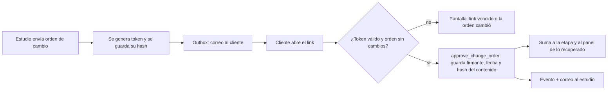
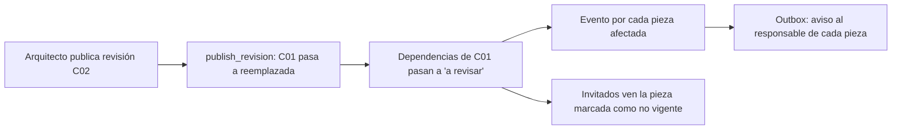
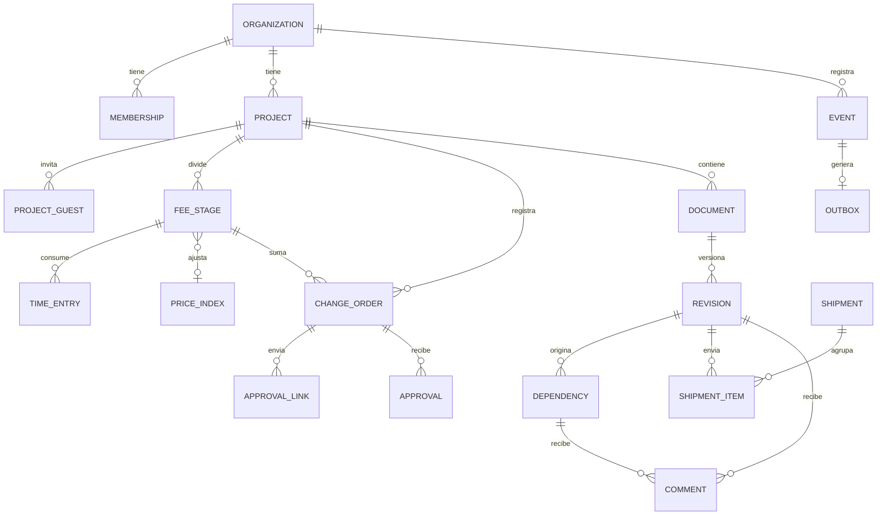

# Plan de desarrollo del MVP backoffice

Actualizado: 15/10/2026 · Autor: Francisco

Versión editable: [Plan de desarrollo del MVP backoffice](https://claude.ai/code/artifact/f29bf78d-7983-4920-861f-833853b60eac) · Propuesta de negocio: `propuesta-mvp-backoffice.md`

---

## 1. Resumen

El MVP se construye en **6 sprints de 2 semanas (12 semanas)** con unas **360 horas** de una persona: 320 de desarrollo, 20 de validación con estudios y 20 de reserva. Cada sprint termina con una demo a los socios de diseño, y el orden sigue a la propuesta: primero lo que genera plata (honorarios, horas y órdenes de cambio), después lo vigente (revisiones, envíos y comentarios).

| Sprint | Semanas | Entrega que se puede mostrar |
| --- | --- | --- |
| 0 | 1–2 | Prototipo navegable y base técnica: empresas, usuarios, permisos, invitados, registro de eventos |
| 1 | 3–4 | Honorarios por etapa y carga de horas |
| 2 | 5–6 | Índices y órdenes de cambio internas |
| 3 | 7–8 | Aprobación del cliente por link y panel de lo recuperado |
| 4 | 9–10 | Revisiones, piezas "a revisar" y registro de envíos |
| 5 | 11–12 | Comentarios anclados, vencimientos, auditoría, exportación y lanzamiento pago |

Todas las horas son estimaciones propias para una persona con experiencia en el stack; si tu gestor ya resuelve usuarios, proyectos y archivos, el sprint 0 se acorta y esas horas pasan a reserva.

## 2. Supuestos y stack técnico

El plan supone un stack Next.js + Supabase, que es el que aparece en tus proyectos locales; si tu gestor usa otro, las épicas y el orden se mantienen y solo cambian los nombres de las piezas.

**Supuestos de trabajo:** una persona, unas 30 horas por semana; el gestor actual ya tiene proyectos, tareas y archivos (si no, el sprint 0 los incluye); un solo idioma (español) y dos monedas (pesos y dólares) a nivel de dato; sin app móvil nativa, solo web adaptable al teléfono.

| Pieza | Elección | Por qué |
| --- | --- | --- |
| Aplicación | Next.js con TypeScript, desplegado en Vercel | Un solo código para interfaz y servidor; vistas públicas para invitados |
| Base de datos | PostgreSQL de Supabase con seguridad por fila (RLS) | Las políticas filtran cada consulta en la base, así un invitado nunca ve datos ajenos aunque falle la aplicación ([RLS](https://supabase.com/docs/guides/database/postgres/row-level-security)) |
| Autenticación | Supabase Auth con enlace mágico o código por correo | Invitados sin contraseña; el enlace vence en 1 hora por defecto y se puede pedir uno cada 60 segundos ([Auth](https://supabase.com/docs/guides/auth/auth-email-passwordless)) |
| Archivos | Supabase Storage (o Cloudflare R2 si crecen) con subida directa por URL firmada | Planos y renders pesados no pasan por el servidor |
| Tareas programadas | Supabase Cron (pg_cron) | Vencimientos, recordatorios y procesamiento de eventos sin servidor aparte ([Cron](https://supabase.com/docs/guides/cron)) |
| Correo | Resend | Avisos de orden de cambio, revisión publicada y vencimientos |
| Visor de PDF | PDF.js (Apache 2.0) | Renderiza planos en el navegador para comentar encima ([PDF.js](https://mozilla.github.io/pdf.js/)) |
| Comentarios sobre imagen | Annotorious (BSD-3, con soporte para React) | Anotaciones sobre renders sin construirlas desde cero ([Annotorious](https://annotorious.dev/)) |
| Validación | zod en formularios y en la API | Las mismas reglas en cliente y servidor |
| Pruebas | Vitest (unidades), Playwright (flujos punta a punta), pruebas SQL de políticas | Los flujos de aprobación y permisos son los que no pueden fallar |
| Exportación | Librería de Excel en el servidor (por ejemplo SheetJS o ExcelJS) | Exportar honorarios y adicionales para facturar |

## 3. Arquitectura

Un monolito modular con cuatro decisiones que conviene tomar en el sprint 0 porque después cuestan caro de cambiar: multiempresa desde el día uno, permisos en la base, invitados con alcance acotado y un registro de eventos del que salen auditoría y avisos.

| Decisión | Cómo | Por qué ahora |
| --- | --- | --- |
| Multiempresa | Cada tabla de negocio lleva `org_id`; un usuario pertenece a una o más organizaciones con un rol | Agregarlo después obliga a migrar todos los datos |
| Permisos en la base | Políticas RLS por `org_id` y por proyecto, con índice en cada columna que filtran y `(select auth.uid())` para cachear el usuario por consulta | La recomendación de Supabase para rendimiento; un error de la aplicación no expone datos |
| Invitados | Tabla `project_guests` (proyecto, correo, tipo: cliente, renderista, contratista); el invitado entra por enlace mágico y solo ve lo compartido con él | Es el canal de crecimiento y el mayor riesgo de fuga de datos |
| Links de aprobación | Token aleatorio de 32 bytes guardado solo como hash, con vencimiento y uso único; no requiere sesión | El cliente aprueba sin crear cuenta, y un token robado de la base no sirve |
| Registro de eventos | Tabla `events` solo de inserción (tipo, entidad, id, actor, datos, fecha), escrita por triggers y funciones | Da la auditoría gratis y alimenta los avisos |
| Avisos | Cada evento que requiere correo crea una fila en `outbox`; un job de Supabase Cron la procesa cada minuto y llama a Resend | Si el correo falla no se pierde ni se bloquea la operación |
| Reglas de estado | Funciones SQL (`approve_change_order`, `publish_revision`) que validan la transición y escriben eventos en la misma transacción | La regla vive en un solo lugar y no se puede saltear desde la interfaz |
| Archivos | Ruta `org/proyecto/documento/revisión/archivo`; subida directa con URL firmada; nunca se sobrescribe un archivo publicado | Lo publicado tiene que ser inmutable para que la aprobación valga |

### Roles y permisos

| Rol | Proyectos | Honorarios y horas | Órdenes de cambio | Revisiones | Comentarios |
| --- | --- | --- | --- | --- | --- |
| Dueño | Todo | Ver y editar | Crear, enviar, anular | Publicar | Sí |
| Miembro del estudio | Asignados | Cargar sus horas; ver etapas | Crear y enviar | Publicar | Sí |
| Cliente invitado | Solo los suyos | No | Ver y aprobar las enviadas a él | Ver lo compartido | Sí |
| Renderista o contratista invitado | Solo los suyos | No | No | Ver lo compartido; subir entregas | Sí |

### Los dos flujos críticos





Editar una orden ya enviada cambia su hash de contenido, y la función de aprobación rechaza el token viejo: es la regla de Houzz Pro (la firma se invalida si se edita) implementada en la base.

## 4. Modelo de datos y reglas

Son 18 tablas nuevas: las de las 9 entidades de negocio de la propuesta (algunas se dividen en dos), más organizaciones, membresías, invitados, links de aprobación, vencimientos, eventos y outbox. Las reglas que no pueden fallar (una sola revisión publicada, aprobación válida solo sobre el contenido enviado) se garantizan con índices y funciones en la base, no en la interfaz.



### Tablas y campos clave

| Tabla | Campos clave | Restricciones |
| --- | --- | --- |
| `organizations`, `memberships` | org, usuario, rol (`owner`, `member`) | Un usuario puede estar en varias organizaciones |
| `project_guests` | proyecto, correo, tipo (`client`, `renderer`, `contractor`), usuario | Único por proyecto y correo |
| `fee_stages` | proyecto, nombre, orden, tipo (`fixed`, `hourly`, `mixed`), monto, moneda, tarifa, horas presupuestadas, índice y valor base | Monto mayor o igual a 0; moneda `ARS` o `USD` |
| `time_entries` | etapa, persona, fecha, horas, nota | Horas entre 0 y 24 |
| `price_indices` | nombre, período, valor, quién lo cargó | Único por organización, nombre y período |
| `change_orders` | proyecto, etapa, número, título, horas, monto, estado, hash del contenido, fechas | Número único por proyecto; estados `draft`, `sent`, `approved`, `rejected`, `billable`, `void` |
| `approval_links` | orden, hash del token, destinatario, vence, usado, hash del contenido enviado | Hash del token único; uso único |
| `approvals` | orden, decisión, nombre y correo del firmante, hash del contenido, IP, navegador, fecha | Solo inserción |
| `documents`, `revisions` | documento (código, título, disciplina); revisión (código, estado, archivo, SHA-256, publicada por y cuándo) | Una sola revisión `published` por documento |
| `dependencies` | tipo de pieza (`render`, `sales_plan`, `brochure`), archivo, revisión de origen, estado, responsable, rondas contratadas | Estados `current`, `to_review`, `obsolete`, `revalidated` |
| `shipments`, `shipment_items` | destinatario, canal, fecha; ítems con revisión o pieza y su SHA-256 | Solo inserción |
| `comments` | archivo (revisión o pieza), autor o invitado, texto, ancla (página y coordenadas o anotación), estado, ronda | — |
| `deadlines` | proyecto, título, fecha, días de aviso, hecho | — |
| `events`, `outbox` | tipo, entidad, actor, datos; envío pendiente, intentos, próximo intento | `events` sin permiso de UPDATE ni DELETE |

### Reglas en SQL

Una sola revisión publicada por documento y política de lectura por organización:

```sql
create unique index one_published_revision
  on revisions (document_id) where status = 'published';

create index on revisions (org_id);

create policy "miembros leen revisiones de su organización"
on revisions for select to authenticated
using (
  org_id in (
    select org_id from memberships
    where user_id = (select auth.uid())
  )
);
```

Publicar una revisión reemplaza la anterior y marca sus dependencias, todo en una transacción:

```sql
create or replace function publish_revision(p_revision_id uuid)
returns void language plpgsql security definer as $$
declare
  v_doc uuid; v_org uuid; v_prev uuid;
begin
  select document_id, org_id into v_doc, v_org
  from revisions where id = p_revision_id for update;

  select id into v_prev from revisions
  where document_id = v_doc and status = 'published' for update;

  if v_prev is not null then
    update revisions set status = 'superseded' where id = v_prev;
    update dependencies set status = 'to_review'
    where source_revision_id = v_prev and status in ('current', 'revalidated');
  end if;

  update revisions
  set status = 'published', published_at = now(), published_by = auth.uid()
  where id = p_revision_id;

  insert into events (org_id, type, entity, entity_id, actor_id, data)
  values (v_org, 'revision.published', 'revision', p_revision_id, auth.uid(),
          jsonb_build_object('superseded', v_prev));
end $$;
```

La aprobación por link valida token, vencimiento y que el contenido no haya cambiado desde el envío:

```sql
create or replace function approve_change_order(
  p_token text, p_decision text, p_signer_name text, p_signer_email text)
returns void language plpgsql security definer as $$
declare
  v_link approval_links%rowtype; v_co change_orders%rowtype;
begin
  select * into v_link from approval_links
  where token_hash = encode(extensions.digest(p_token, 'sha256'), 'hex')
    and used_at is null and expires_at > now()
  for update;
  if not found then raise exception 'link inválido o vencido'; end if;

  select * into v_co from change_orders where id = v_link.change_order_id for update;
  if v_co.status <> 'sent' or v_co.content_hash <> v_link.content_hash then
    raise exception 'la orden cambió desde el envío';
  end if;

  insert into approvals (org_id, change_order_id, decision, signer_name, signer_email, content_hash)
  values (v_co.org_id, v_co.id, p_decision, p_signer_name, p_signer_email, v_co.content_hash);

  update change_orders
  set status = case when p_decision = 'approved' then 'approved' else 'rejected' end,
      decided_at = now()
  where id = v_co.id;

  update approval_links set used_at = now() where id = v_link.id;

  insert into events (org_id, type, entity, entity_id, actor_email, data)
  values (v_co.org_id, 'change_order.' || p_decision, 'change_order', v_co.id, p_signer_email, '{}');
end $$;
```

El `content_hash` de la orden se recalcula en un trigger cada vez que cambian título, descripción, horas o monto; por eso cualquier edición después del envío invalida el link. Los fragmentos son una base para adaptar, no código probado: falta validar `p_decision`, permisos de ejecución de cada función y sus pruebas.

## 5. Backlog por épicas

14 épicas; cada una tiene criterios de aceptación verificables, que son los que deciden si una épica está terminada, no la sensación de que "ya anda".

| # | Épica | Historias principales | Criterios de aceptación | Sprint |
| --- | --- | --- | --- | --- |
| E0 | Fundaciones | Organizaciones y roles; políticas RLS; invitación de miembros e invitados; tabla de eventos; outbox con cron y correo; CI con pruebas | Un usuario de otra organización no lee ninguna fila (prueba automática por tabla); un invitado solo ve su proyecto; cada alta o cambio de entidad de negocio deja un evento | 0 |
| E1 | Honorarios por etapa | Plantilla de etapas argentinas (croquis, anteproyecto, documentación, dirección de obra); tipo fijo, por hora o mixto; moneda | Crear un proyecto con 4 etapas desde la plantilla en menos de 2 minutos; el total del proyecto suma las etapas y sus adicionales | 1 |
| E2 | Horas | Carga desde el teléfono; vista de horas por etapa contra presupuesto; aviso al 80% y al 100% | Cargar horas en 3 toques desde el teléfono; el aviso llega una sola vez por umbral | 1 |
| E3 | Índices | Carga del valor mensual; vínculo de una etapa con un índice y su valor base; vista de montos actualizados | Monto actualizado = monto × índice actual ÷ índice base, redondeado a 2 decimales; el historial de valores queda guardado | 2 |
| E4 | Órdenes de cambio | Crear con horas, monto y documentos afectados; numeración por proyecto; enviar por link; aprobar o rechazar sin cuenta; anular | Un link usado o vencido no funciona; editar después del envío invalida el link; la aprobada suma a su etapa; queda guardado quién, cuándo y qué contenido aprobó | 2 y 3 |
| E5 | Panel de lo recuperado | Total aprobado por proyecto y por mes; pendientes de aprobación | Coincide al centavo con la suma de órdenes aprobadas | 3 |
| E6 | Revisiones y dependencias | Subir revisión; estados; publicar; vincular piezas (render, plano de venta, brochure) a la revisión de origen; bandeja "a revisar" | Nunca hay dos revisiones publicadas del mismo documento; al publicar, todas las piezas dependientes pasan a "a revisar" y su responsable recibe aviso | 4 |
| E7 | Registro de envíos | Enviar revisiones o piezas a un invitado; historial por destinatario | Cada envío guarda la huella SHA-256 del archivo enviado; se puede responder "qué vio este cliente y cuándo" en una pantalla | 4 |
| E8 | Comentarios y rondas | Comentar sobre un punto del PDF o del render; resolver; contador de rondas contratadas y usadas | El comentario queda anclado a la versión exacta; al superar las rondas contratadas aparece un aviso | 5 |
| E9 | Vencimientos | Crear vencimientos propios con avisos (30, 15, 5 días o los que elija) | El aviso sale una sola vez por umbral y se puede marcar como hecho | 5 |
| E10 | Auditoría y exportación | Historial por proyecto; exportar etapas, horas y adicionales a Excel | Toda aprobación aparece en el historial; el Excel abre sin errores y cuadra con el panel | 5 |
| E11 | Puesta en marcha | Plantillas de proyecto; carga masiva de documentos; proyecto de ejemplo | Un estudio nuevo tiene un proyecto real cargado en menos de 30 minutos | 5 |
| E12 | Calidad y seguridad | Pruebas de políticas, flujos punta a punta, copias de seguridad, límites de subida | Los flujos de aprobación y publicación pasan en CI; restauración de copia probada una vez | Todos |
| E13 | Lanzamiento | Página de producto; términos y privacidad (texto revisado por un abogado); alta de cuentas pagas con cobro manual | Un estudio puede pasar de prueba a pago sin intervención técnica | 5 |

El cobro de las primeras cuentas es manual (transferencia y factura emitida por vos o tu contador): integrar una pasarela de pagos no aporta nada con 5 a 10 clientes y suma trabajo.

## 6. Estimación de horas

Las dos épicas que hacen único al producto (órdenes de cambio aprobadas y revisiones con dependencias) se llevan 90 de las 320 horas de desarrollo; las fundaciones, otras 40, se pagan una sola vez.

| Épica | Horas estimadas |
| --- | --- |
| E4 Órdenes de cambio | 45 |
| E6 Revisiones y dependencias | 45 |
| E0 Fundaciones | 40 |
| E8 Comentarios y rondas | 35 |
| E1 Honorarios por etapa | 30 |
| E2 Horas | 25 |
| E7 Registro de envíos | 16 |
| E12 Calidad y seguridad | 16 |
| E10 Auditoría y exportación | 14 |
| E3 Índices | 12 |
| E5 Panel de lo recuperado | 12 |
| E9 Vencimientos | 12 |
| E11 Puesta en marcha | 12 |
| E13 Lanzamiento | 6 |
| **Total desarrollo** | **320** |

Con 30 horas por semana durante 12 semanas hay 360 horas: 320 de desarrollo, 20 para entrevistas y demos y 20 de reserva. Si a mitad de camino se consumió la reserva, aplicar los recortes de la sección 9 antes de mover la fecha de lanzamiento.

## 7. Plan por sprints

Cada sprint dura dos semanas, termina con una demo a los socios de diseño y deja algo que un estudio puede usar con datos reales.

### Épicas por semana

| Épica | Semanas |
| --- | --- |
| E0 Fundaciones | 1–2 |
| E1 Honorarios por etapa | 3–4 |
| E2 Horas | 3–4 |
| E3 Índices | 5 |
| E4 Órdenes de cambio | 5–7 |
| E5 Panel de lo recuperado | 7–8 |
| E6 Revisiones y dependencias | 7–9 |
| E7 Registro de envíos | 9–10 |
| E8 Comentarios y rondas | 10–11 |
| E9 Vencimientos | 11 |
| E10 Auditoría y exportación | 11–12 |
| E11 Puesta en marcha | 12 |
| E13 Lanzamiento | 12 |
| E12 Calidad (continua) | 1–12 |
| Demos a socios de diseño | Fin de las semanas 2, 4, 6, 8, 10 y 12 |
| Compuertas | Semana 2 (problema confirmado), semana 7 (uso semanal), semana 12 (lanzamiento pago) |

### Objetivos y demos

| Sprint | Semanas | Objetivo | Demo al cierre | Horas planificadas |
| --- | --- | --- | --- | --- |
| 0 | 1–2 | Base técnica y validación: E0, entrevistas, prototipo navegable, CI | Prototipo de las tres pantallas clave; un invitado entra por enlace y solo ve su proyecto | 54 (10 validación, 40 E0, 4 calidad) |
| 1 | 3–4 | Honorarios por etapa y horas: E1, E2 | Un socio carga un proyecto real con sus etapas y una semana de horas | 57 |
| 2 | 5–6 | Índices y órdenes de cambio internas: E3, mayor parte de E4 | Honorarios actualizados por índice; orden de cambio creada y numerada | 57 |
| 3 | 7–8 | Aprobación por link y panel: cierre de E4, E5, inicio de E6 | Un cliente real aprueba una orden desde el teléfono y aparece en el panel | 57 |
| 4 | 9–10 | Lo vigente: cierre de E6, E7, inicio de E8 | Publicar una revisión marca las piezas dependientes; historial de envíos por cliente | 56 |
| 5 | 11–12 | Cierre y lanzamiento: E8, E9, E10, E11, E13 | Un estudio nuevo se da de alta, carga un proyecto y pasa a pago | 59 |

Cada sprint incluye unas 2 horas de demo y unas 3 de calidad (E12). Las 340 horas planificadas dejan 20 de reserva: conviene no asignarlas y usarlas solo para lo que se trabe.

## 8. Calidad, pruebas y seguridad

La prioridad de las pruebas no es la cobertura sino los dos lugares donde un error destruye la confianza: que alguien vea datos ajenos y que una aprobación o una revisión publicada no sea la que se cree.

### Definición de terminado

Una historia está terminada cuando:

- [ ] Cumple sus criterios de aceptación del backlog.
- [ ] Toda tabla nueva tiene `org_id`, política RLS, índice en las columnas que filtran y una prueba de que otra organización no la lee.
- [ ] Los cambios de estado pasan por una función SQL que escribe su evento.
- [ ] Funciona en el teléfono (ancho de 375 px) para las pantallas que usan invitados.
- [ ] Los textos están en español rioplatense y los montos muestran moneda.
- [ ] Está desplegada en el entorno de prueba y la vio al menos un socio de diseño.

### Qué probar y cómo

| Qué | Tipo de prueba | Casos mínimos |
| --- | --- | --- |
| Aislamiento entre organizaciones | Pruebas SQL de políticas con dos usuarios de organizaciones distintas | Leer, insertar, actualizar y borrar en cada tabla de negocio |
| Invitados | Punta a punta (Playwright) | El invitado ve solo su proyecto; no ve horas ni honorarios; no puede publicar |
| Aprobación por link | Punta a punta y unidad | Link válido; vencido; usado; orden editada después del envío; rechazo |
| Publicación de revisiones | Unidad sobre la función SQL | Dos publicaciones simultáneas del mismo documento (debe fallar una); dependencias marcadas |
| Cálculos | Unidad (Vitest) | Ajuste por índice; totales por etapa con adicionales; panel de lo recuperado |
| Avisos | Integración con correo de prueba | Un evento genera un solo correo; reintento si falla el envío |

### Seguridad mínima antes de lanzar

- Clave de servicio de Supabase solo en el servidor, nunca en el navegador.
- Funciones `security definer` con `search_path` fijo y permiso de ejecución solo para los roles que las usan.
- Tokens de aprobación guardados como hash, con vencimiento y uso único.
- Límite de tamaño y tipo en la subida de archivos; URLs firmadas con vencimiento corto para descargar.
- Copias de seguridad diarias y una restauración probada.
- Registro de errores en producción y alerta cuando falla el procesamiento del outbox.

## 9. Riesgos técnicos y recortes

El mayor riesgo de un MVP hecho por una sola persona es que el alcance crezca y la fecha se mueva; por eso los recortes están decididos de antemano, en orden.

| Riesgo | Señal temprana | Mitigación |
| --- | --- | --- |
| Comentarios anclados sobre PDF e imagen más complejos de lo previsto | E8 supera 20 horas sin terminar el PDF | Usar Annotorious solo para imágenes y comentarios por página (sin coordenadas) para PDF |
| Políticas RLS lentas o mal escritas | Consultas de más de 300 ms con pocos datos | Índices en columnas filtradas, `(select auth.uid())`, revisar con `explain` |
| Correos que caen en spam | Socios que no reciben el link de aprobación | Dominio propio verificado en Resend; copia del link visible para enviarlo por WhatsApp |
| Archivos muy pesados (planos de más de 100 MB) | Subidas que fallan | Subida directa a almacenamiento con URL firmada y por partes; límite claro en la interfaz |
| El gestor actual no encaja con multiempresa | E0 supera 40 horas | Migrar primero el modelo de datos y dejar la interfaz vieja hasta el sprint 1 |
| Dispersión de alcance | Pedidos de socios fuera de las dos capas | Anotarlos en una lista "después del lanzamiento" y revisarla en cada demo |

### Qué recortar si te atrasás, en este orden

1. **Puesta en marcha (E11):** cargar a mano los proyectos de los primeros clientes.
2. **Comentarios anclados (E8):** comentarios por archivo sin ubicación en la imagen; mantener el contador de rondas.
3. **Vencimientos (E9):** posponer para después del lanzamiento.
4. **Registro de envíos (E7):** guardar solo destinatario, fecha y huella del archivo, sin pantalla de historial.
5. **Exportación (E10):** CSV en lugar de Excel con formato.

No se recortan nunca E0 (seguridad), E4 (órdenes de cambio) ni E6 (revisiones): son el producto.

## 10. Checklist de lanzamiento

- [ ] Pruebas de aislamiento entre organizaciones en verde para todas las tablas.
- [ ] Flujos punta a punta de aprobación por link y publicación de revisiones en verde.
- [ ] Copia de seguridad diaria activa y una restauración probada.
- [ ] Dominio propio verificado para correos; plantillas de aviso en español.
- [ ] Registro de errores en producción y alerta del outbox.
- [ ] Términos y condiciones y política de privacidad publicados, revisados por un abogado.
- [ ] Página de producto con precio fundador y formulario de prueba.
- [ ] Proceso de cobro manual definido con tu contador (transferencia y factura).
- [ ] Los 5 socios de diseño migrados a cuenta paga o con fecha de pase.
- [ ] Lista "después del lanzamiento" priorizada para la segunda etapa (unidades y brokers).

## Referencias

- Propuesta de negocio: [Propuesta de negocio: MVP backoffice](https://claude.ai/code/artifact/6e7a3f65-b041-4674-848e-1dd8b15ce449) · investigación completa: [Gestión integral de desarrollos inmobiliarios](https://claude.ai/code/artifact/cbdbe68c-f386-48e7-9da3-abe7ae1f27ad)
- Supabase: [seguridad por fila](https://supabase.com/docs/guides/database/postgres/row-level-security) · [acceso sin contraseña](https://supabase.com/docs/guides/auth/auth-email-passwordless) · [Cron](https://supabase.com/docs/guides/cron) · [precios](https://supabase.com/pricing)
- Visores y anotación: [PDF.js](https://mozilla.github.io/pdf.js/) · [Annotorious](https://annotorious.dev/)
- Infraestructura: [Vercel](https://vercel.com/pricing) · [Resend](https://resend.com/pricing) · [Cloudflare R2](https://developers.cloudflare.com/r2/pricing/)
- Funciones de referencia de competidores: [órdenes de cambio en JobTread](https://www.jobtread.com/features/change-orders) · [órdenes de cambio en Houzz Pro](https://pro.houzz.com/pro-help/r/creating-and-sending-change-orders) · [reemplazo de revisiones en Aconex](https://help.aconex.com/documents/update-supersede-a-document/) · [fases en Monograph](https://monograph.com/features/project-planning)
