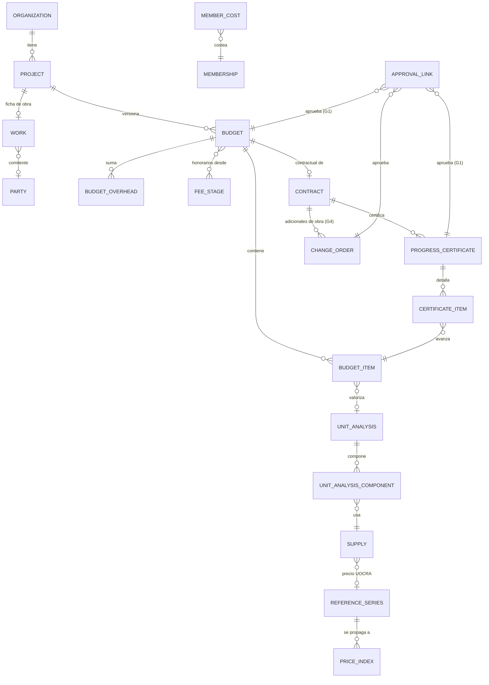

# Plan de sprints: Finanzas de obra, Presupuesto y Contabilidad

Actualizado: 19/10/2026 · Autor: Francisco · Generado con `docs/prompt-plan-de-sprints.md` (versión 2)

Documentos base: [`analisis-y-roadmap-finanzas-de-obra.md`](analisis-y-roadmap-finanzas-de-obra.md) · [`plan-desarrollo-mvp.md`](plan-desarrollo-mvp.md) · [`propuesta-mvp-backoffice.md`](propuesta-mvp-backoffice.md)

**Marcas:** **[I]** inferencia o criterio propio · **[C]** validar con un profesional (contador, abogado o profesional de cómputos) antes del sprint que lo usa.

---

## 1. Resumen

El plan tiene **65 sprints semanales**, unas **1.060 horas planificables** a 20 h por semana, ya descontados los feriados. Se divide en una primera versión vendible (**R1, 14 sprints**) y cinco oleadas más, que se vuelven a planificar en cada compuerta. **Solo los sprints 1 a 8 están detallados**; el resto queda a nivel de épica, como pide el prompt.

| Hito | Sprints | Fecha estimada de fin | Qué queda andando |
| --- | --- | --- | --- |
| **R1: primera versión vendible** | 1–14 | **viernes 5/2/2027** | Ficha de obra con el papel de la empresa, series de referencia, costo interno y rentabilidad, insumos, análisis de precios, presupuesto en tres niveles aprobado por link, contrato, anticipo y certificados con ajuste CAC y fondo de reparo |
| **Compuerta R1** | 18 | 5/3/2027 | Decisión de seguir, corregir o frenar con datos de 3 a 5 socios de diseño |
| **Etapa P** (presupuesto) | P1 y P2 en R1; P3 en las oleadas 3 y 5 | P2: 8/1/2027 · P3 completo: 19/11/2027 (si la prueba de concepto da "sigue") | Presupuesto completo; cómputo desde IFC, PDF y renders |
| **Etapa A** (finanzas de obra) | A1 en R1; A2 a A5 en las oleadas 2 a 4 | 27/8/2027 (**Compuerta R2**) | Compras, subcontratos, comprobantes, tesorería, cuentas corrientes y tablero |
| **Etapa B** (contabilidad de gestión) | Oleada 5 | 22/10/2027 | Plan de cuentas, asientos automáticos, libros y estados de gestión |
| **Etapa C** (integraciones) | Oleada 6 | 11/2/2028 | Xubio, Colppy, factura electrónica por terceros y fideicomisos |

El total es **un poco más largo que la estimación inicial de ~15 meses**: al planificar por épica dieron unos 16. Si la prueba de concepto del cómputo asistido da "no sigue", se ahorran 7 sprints (G2 se hace igual) y el plan termina el 17/12/2027.

### Supuestos

- Una persona, 20 h por semana; **17 h planificables** por sprint (15% de reserva).
- En las semanas con un feriado se planifican 14 h; con carnaval, 10 h.
- **Feriados en R1** (fuente: [Bloomberg Línea](https://www.bloomberglinea.com/latinoamerica/argentina/proximo-feriado-en-argentina-quedan-cuatro-fines-de-semana-largos-en-2026-y-uno-que-sera-xl-para-algunos/)):
  - lunes 23/11 (Soberanía Nacional, trasladado);
  - martes 8/12 (el lunes 7/12 es un día no laborable optativo: se supone que se trabaja);
  - viernes 25/12;
  - viernes 1/1/2027.
- **Carnaval 2027:** lunes 8 y martes 9/2, calculado desde la Pascua del 28/3/2027 [I].
- **Feriados desde abril de 2027:** calculados con la regla de traslado de la Ley 27.399, sin días no laborables optativos [I].
- **Vacaciones** [I]:
  - del 28/12/2026 al 1/1/2027;
  - del 19 al 23/7/2027;
  - del 27 al 31/12/2027.

  Las de 2027 no estaban en el prompt: si no las tomás, el plan termina dos semanas antes.
- Se mantiene "un estudio por persona" hasta B1. Ahí el rol contador obliga a sumar el **selector de organizaciones**, porque un contador atiende a varias empresas (análisis, §1.3, n.º 6).
- Los cálculos de dinero viven en vistas y funciones SQL, como `fee_stage_summary`, y se prueban con pgTAP. Vitest prueba las funciones TypeScript que repiten un cálculo para mostrarlo en vivo en un editor.
- Los coeficientes y plantillas iniciales (tipología, calidad, rubros, indirectos) son **valores orientativos y editables** [I], hasta que los valide un profesional de cómputos.

### Lo que encontré al revisar el esquema

Al cruzar el prompt con las migraciones aparecieron cuatro cosas que el análisis no decía o simplificaba. Ya están incorporadas al plan:

1. **Las órdenes de cambio actuales son adicionales de honorarios, no de obra.** `change_orders.stage_id` apunta a `fee_stages` y es obligatorio. Para que un adicional de obra (un cambio que pide el comitente en la construcción) llegue al certificado hace falta ampliar la tabla. **Es la tarea G4 (sprint 12).**
2. **`approvals` también tiene `change_order_id` obligatorio,** igual que `approval_links`. G1 generaliza las dos tablas (sprint 9).
3. **`price_indices` es por organización y la carga el dueño.** Las series que publica alguien de afuera (CAC, ICC Córdoba, UOCRA, FACPCE) conviene cargarlas una vez para todos y que cada organización las adopte. Va en el sprint 2.
4. **`memberships.role` solo admite `owner` y `member`, y `organizations.plan` solo `trial`, `estudio` y `pro`.**
   - El rol "contador" necesita un rol nuevo (oleada 5).
   - Los planes de constructora necesitan ampliar el `check` (oleada 2).
   - En R1, las funciones nuevas se habilitan por organización con `organizations.beta_features`, que carga la plataforma para los socios de diseño.

### Preguntas abiertas para Francisco

1. **¿Quién arma la biblioteca base de rendimientos?** Hacen falta 10 ítems antes del sprint 5 y entre 30 y 60 antes del sprint 10. Las opciones son vos con un profesional de cómputos contratado, un socio de diseño a cambio de un plan gratis, o cada empresa con lo suyo, sin biblioteca base. Sin respuesta, el sprint 5 se demuestra con ítems de ejemplo.
2. **¿Tenés ya una constructora candidata a socia de diseño?** La compuerta R1 la exige. Hay que conseguirla antes del sprint 6 para que use el presupuesto en el sprint 8.
3. **¿La semana de vacaciones de fin de año es la del 28/12?** Si es otra, se corre R1 una semana.

### Biblioteca de precios y rendimientos: quién mantiene qué

| Parte | Responsable | Frecuencia | Sprint |
| --- | --- | --- | --- |
| Biblioteca base de análisis de precios (10 ítems; luego de 30 a 60) | Plataforma, curada con un profesional de cómputos (pregunta abierta 1) | Al inicio; revisión anual | 5 (catálogo) |
| Precios de materiales, equipos y subcontratos | Cada organización: carga o importa sus listas | Cuando cambian | 4 |
| Series de referencia: CAC, ICC Córdoba, FACPCE | Plataforma (`/admin/series`) | Mensual, del 19 al 24 para la CAC, con rectificaciones | 2 |
| Escala UOCRA por categoría | Plataforma | En cada paritaria | 2 y 4 |
| Costo de referencia por m² del paramétrico | Se toma de la serie ICC Córdoba adoptada; si no, a mano | Mensual (con la serie) | 1 (a mano) y 8 (desde la serie) |
| Coeficientes de tipología, calidad, cargas y pase | Cada organización, con valores iniciales orientativos [I] | Cuando el profesional o el contador los valida | 1, 4 y 7 |

### Lo que queda afuera de R1 a propósito

Estos recortes son decisiones tomadas, no atrasos:

- Acopio, garantías y pólizas, certificado final y devolución del fondo de reparo: A1 resto, oleada 2 y 3.
- PDF del presupuesto: R1 tiene una **vista imprimible** (se guarda como PDF desde el navegador).
- Pegar ítems desde Excel en el editor del presupuesto.
- Portal del contratista: en R1 el director carga el certificado del contratista; el portal llega con A2.
- Fondos del comitente en obras por administración: en R1 el papel de administrador se registra, pero el manejo de fondos llega con A4.
- Comprobantes con CAE y QR: en R1 el certificado solo registra "facturado" con el número del comprobante externo.

---

## 2. Mapa de etapas e hitos

| Etapa | Sprints | Fechas | Entrega demostrable | Compuerta |
| --- | --- | --- | --- | --- |
| **Oleada 1a.** Fundaciones y presupuesto | 1–8 | 26/10 – 18/12/2026 | Un socio arma el presupuesto de una obra real: paramétrico → por ítem con APU, indirectos, honorarios y pase; versiones, ajuste por índice y Excel | **Compuerta 1 (18/12):** al menos 2 socios cargaron un presupuesto real por ítem |
| **Oleada 1b.** Aprobación y certificados | 9–14 | 21/12/2026 – 5/2/2027 | El comitente aprueba el presupuesto por link y queda como contractual; se emiten y aprueban certificados mensuales con ajuste CAC, anticipo y fondo de reparo | **R1 lista (5/2)** |
| **Oleada 2.** Uso real y cierre de la plata | 15–22 | 8/2 – 2/4/2027 | Prueba de concepto del cómputo asistido; cobro automático del plan; comprobantes; facturado y cobrado | **Compuerta R1 (5/3, sprint 18)** |
| **Oleada 3.** Obra completa | 23–33 | 5/4 – 18/6/2027 (el sprint 23 termina A1 resto) | Compras, subcontratos con portal del contratista, acopio y garantías; presupuestos "a revisar" (G2); IFC si la prueba dio "sigue" | Compuerta 3 (18/6) |
| **Oleada 4.** Tesorería y tablero | 34–42 | 21/6 – 27/8/2027 (con vacaciones en julio) | Cajas, bancos, cheques y ECHEQ, cuentas corrientes, fondos del comitente; tablero de obra | **Compuerta R2 (27/8):** finanzas de obra completas |
| **Oleada 5.** Contabilidad de gestión | 43–55 | 30/8 – 26/11/2027 | Asientos automáticos, Diario, Mayor, Sumas y saldos, estados de gestión, rol contador con selector de organizaciones; cómputo desde PDF y renders | Compuerta 5 (26/11) |
| **Oleada 6.** Integraciones | 56–65 | 29/11/2027 – 11/2/2028 (con vacaciones en diciembre) | Exportación a Colppy y Xubio, factura electrónica por terceros, fideicomisos al costo | Cierre |

**Revisiones cortas entre compuertas.**

- **Cuándo:** en los sprints 4, 12, 23, 28, 38, 47, 51 y 60, una revisión de 1 h dentro del sprint: horas reales contra planificadas, métricas y recortes. Las revisiones y las compuertas quedan como mucho a 5 sprints de distancia.
- **Desvío del prompt:**
  - El prompt pedía endurecimiento cada 4 o 5 sprints. Con 17 h por semana eso cuesta ~12% de la capacidad. Por eso el endurecimiento va **en los sprints 14, 18, 33, 42, 55 y 65**, y la calidad se sostiene con la definición de terminado de cada sprint.
  - El sprint 9 (G1) también funciona como sprint de calidad: es una refactorización con pruebas de regresión.

---

## 3. Primera oleada: sprints 1 a 8 (detallados)

Cada sprint cumple la definición de terminado del prompt:

- migración con pgTAP de aislamiento y de reglas de estado;
- Vitest donde haya cálculo en TypeScript;
- Playwright para el flujo principal **de cada épica**, cuando ese flujo ya existe de punta a punta:
  - F0: ficha de obra y paramétrico, en el sprint 2;
  - P1: insumo → análisis de precio, en el 5;
  - P2: presupuesto completo, en el 8;
  - G1 y P2: aprobación del presupuesto, en el 10;
  - A1: certificado, en el 14;
  - la publicación de revisiones se cubre antes de G2;
- lint, tipos y build en verde;
- demo de 5 minutos;
- README actualizado.

Las pruebas de la base siguen la numeración existente (la última suite es `14_orden_rechazada`).

### Sprint 1 · 26/10 – 30/10 · 17 h · Ficha de obra y estimación paramétrica

**Objetivo:** que cualquier proyecto tenga su ficha de obra y una primera estimación de costo en dos minutos.
**Épicas:** F0 (núcleo) y P2 (nivel 1).

| Historia | Criterios de aceptación |
| --- | --- |
| Como dueño, quiero marcar mi organización como estudio o constructora para ver las funciones que me corresponden | `organizations.kind` en (`studio`, `builder`), con `studio` por defecto. Solo el dueño lo cambia, mediante `set_organization_kind`, que deja un evento. El grupo "Obra" de la barra lateral aparece solo si `beta_features` incluye `works` |
| Como miembro, quiero completar la ficha de obra de un proyecto para tener los datos base | Una ficha por proyecto. **El papel es obligatorio:** `builder`, `works_director` o `administrator`. Además: dirección, ciudad, m² cubiertos > 0, m² semicubiertos ≥ 0, tipología, calidad, fechas previstas y moneda. Los invitados no la leen (pgTAP). Queda un evento por alta y por cambio |
| Como dueño, quiero una estimación paramétrica para darle al cliente un orden de magnitud en el croquis | Total = (m² cubiertos + m² semicubiertos × factor) × costo de referencia por m² × coeficiente de tipología × coeficiente de calidad, redondeado a 2 decimales. El factor de semicubiertos es 0,5 por defecto, editable [I]. Se guarda como **versión 1 del presupuesto, nivel paramétrico**, con el costo de referencia, su fecha y su origen (en este sprint se carga a mano). Muestra total y costo por m² |

- **Base:**
  - `organizations.kind` y `organizations.beta_features text[]` (los escribe solo la plataforma).
  - `works`: 1 a 1 con `projects`; `org_role`, datos físicos, fechas y moneda.
  - `budgets`, la cabecera del presupuesto:
    - `project_id` y `number`, con numeración por proyecto con bloqueo, como `create_change_order`;
    - `level` (`parametric`, `by_chapter`, `by_item`) y `status` (`draft`, `sent`, `approved`, `rejected`, `contractual`, `superseded`, `void`);
    - `currency` y los datos paramétricos.
  - `parametric_coefficients` (org, dimensión, clave, valor), sembrada al crear la organización [I].
  - Funciones `upsert_work` y `create_parametric_budget`; vista `budget_totals`, por ahora solo paramétrica.
  - Las tres tablas nuevas con RLS de miembros y auditoría.
- **Pantallas:** pestaña "Obra" en `/proyectos/[id]`, que lleva a `/proyectos/[id]/obra`, y pestaña "Presupuestos" (`/proyectos/[id]/presupuestos`) con el alta del paramétrico. En `seed.sql`: ficha de obra para Edificio Alba.
- **Pruebas:**
  - pgTAP `15_obras_y_parametrico`: otra organización no lee `works` ni `budgets`; un invitado no los lee; dos altas simultáneas no repiten número; fórmula del paramétrico con valores del seed.
  - Vitest: formato de m² y del costo por m².

| Tarea | Horas |
| --- | --- |
| Migración, RLS y funciones | 5 |
| pgTAP | 2 |
| Ficha de obra (pantalla y acción) | 4 |
| Presupuesto paramétrico (pantalla y acción) | 4 |
| Seed, demo y README | 2 |
| **Total** | **17** |

- **Dependencias:** ninguna.
- **Riesgos:** coeficientes inventados. Mitigación: se muestran como "orientativos, editables" y los valida el profesional de cómputos antes de la compuerta 1.
- **Demo:** Ana completa la ficha de Edificio Alba como directora de obra y obtiene la estimación paramétrica con su costo por m².

### Sprint 2 · 2/11 – 6/11 · 17 h · Series de referencia, tipo de cambio y Playwright

**Objetivo:** que los índices que publican otros (CAC, ICC Córdoba, UOCRA, FACPCE) se carguen una vez para todos y que haya pruebas punta a punta antes de tocar la aprobación por link.
**Épicas:** F0 y X.

| Historia | Criterios de aceptación |
| --- | --- |
| Como administrador de la plataforma, quiero cargar los valores mensuales de las series de referencia pegándolos desde una planilla, para no hacerlo en cada estudio | Un valor por serie y período. Se puede marcar como **provisorio**; rectificarlo deja en un evento el valor anterior. Solo `platform_admins` escribe (pgTAP). Series iniciales: CAC general, CAC materiales, CAC mano de obra, ICC Córdoba, UOCRA por categoría (ayudante, medio oficial, oficial, oficial especializado) y FACPCE RT 6 |
| Como dueño, quiero adoptar una serie para usarla en mis etapas y presupuestos sin cargarla a mano | Al adoptarla se copia el historial a `price_indices` con un nombre local, así `fee_stage_summary` sigue igual. Cada valor nuevo o rectificado se propaga en la misma transacción a las organizaciones que la adoptaron. Un nombre adoptado no se edita a mano |
| Como dueño, quiero cargar el tipo de cambio del día para comparar montos en pesos y en dólares | Un valor por organización, moneda, fecha y fuente. Los cálculos usan el último valor anterior o igual a la fecha |
| Como desarrollador, quiero pruebas punta a punta del flujo de aprobación actual para refactorizarlo sin miedo en el sprint 9 | Playwright instalado y corriendo en CI. Tres pruebas en verde: el cliente aprueba la OC-001 del seed; un link de una orden editada después del envío muestra "la orden cambió"; se completa la ficha de obra y se crea el paramétrico (flujo de F0) |

- **Base:**
  - `reference_series` (código, nombre, unidad, editor, URL de la fuente) y `reference_values` (serie, período, valor, provisorio, nota): sin `org_id`, con lectura para usuarios autenticados y escritura solo vía `private.is_platform_admin()`.
  - `org_reference_series`, con un trigger que propaga los valores.
  - `exchange_rates`.
  - Funciones `load_reference_values(series, rows jsonb)` y `adopt_reference_series`.
- **Pantallas:** `/admin/series` (plataforma), "Adoptar serie" y "Tipo de cambio" en `/indices`.
- **Pruebas:**
  - pgTAP `16_series_referencia`: un no administrador no escribe; la propagación funciona; la rectificación queda en un evento.
  - Playwright: `e2e/aprobacion-orden.spec.ts`.

| Tarea | Horas |
| --- | --- |
| Series, funciones y pgTAP | 6 |
| `/admin/series` con pegado desde planilla | 2 |
| Adoptar serie en `/indices` | 2 |
| Tipo de cambio | 2 |
| Playwright: instalación, job de CI y 3 pruebas | 4 |
| Demo y README | 1 |
| **Total** | **17** |

- **Dependencias:** ninguna.
- **Riesgos:** el job punta a punta necesita Supabase completo (Auth incluido), que es lento en CI. Mitigación: usar los botones de ingreso de desarrollo que ya existen y correr el job solo en `main` y en los PR con la etiqueta `e2e`. Qué zona de UOCRA corresponde a Córdoba **[C]**: se valida antes de este sprint (validación 2). Si no llega, la serie UOCRA se carga como "Zona A, provisoria".
- **Demo:** cargar la CAC de septiembre como provisoria, adoptarla en el estudio y ver cómo se actualiza una etapa ajustada por índice.

### Sprint 3 · 9/11 – 13/11 · 17 h · Costo interno, rentabilidad y terceros

**Objetivo:** que el estudio sepa si gana plata en cada proyecto y que existan los terceros (comitentes y proveedores) que necesita todo lo que sigue.
**Épicas:** F0.

| Historia | Criterios de aceptación |
| --- | --- |
| Como dueño, quiero cargar el costo por hora de cada persona con fecha de vigencia, para medir la rentabilidad | **Solo el dueño lo lee y lo edita**: un miembro no ve la tabla (pgTAP). Cada hora cargada usa el costo vigente a su fecha. Queda un evento por cambio |
| Como dueño, quiero ver la rentabilidad de cada proyecto y etapa para saber dónde pierdo | Rentabilidad = honorario ajustado + adicionales aprobados − Σ horas × costo vigente, separada por moneda. Coincide al centavo con un cálculo manual del seed. Si falta el costo de alguien, se avisa quién falta, sin asumir cero |
| Como miembro, quiero registrar terceros y vincular el comitente a la ficha de obra, para usarlos en presupuestos, contratos y compras | El CUIT se valida con el dígito verificador y es único por organización. Roles múltiples: comitente, proveedor, subcontratista. Condición frente al IVA y a IIBB. `works.client_party_id` |

- **Base:**
  - `member_costs` (org, usuario, costo, moneda, vigencia desde), con RLS solo para el dueño.
  - Vista `project_profitability` (`security_invoker`).
  - `parties` y `works.client_party_id`.
- **Pantallas:** costo por hora en `/equipo` (solo el dueño); rentabilidad en la sección de honorarios del proyecto y una columna en `/recuperado`; `/terceros` nuevo, en el grupo "Obra".
- **Pruebas:**
  - pgTAP `17_costos_y_terceros`: el miembro no lee costos; la vigencia se aplica bien; el CUIT se rechaza si es inválido o está repetido.
  - Vitest: validador de CUIT en `validation.ts`.

| Tarea | Horas |
| --- | --- |
| Costos, vista y pgTAP | 6 |
| Pantallas de costo y rentabilidad | 4 |
| Terceros: base, CUIT y pgTAP | 3 |
| Pantalla de terceros | 3 |
| Demo y README | 1 |
| **Total** | **17** |

- **Dependencias:** sprint 1 (ficha de obra).
- **Riesgos:** la rentabilidad es un dato sensible. Mitigación: la vista depende de `member_costs`, que un miembro no lee, así que a un miembro le devuelve vacío.
- **Demo:** Edificio Alba muestra su rentabilidad por etapa con los costos de Ana y Beto.

### Sprint 4 · 16/11 – 20/11 · 17 h · Biblioteca de insumos

**Objetivo:** que la empresa tenga sus materiales, mano de obra, equipos y personal con precio y fecha, cargados en minutos desde Excel.
**Épicas:** P1.

| Historia | Criterios de aceptación |
| --- | --- |
| Como miembro, quiero cargar insumos con unidad, precio, moneda, fecha y proveedor, para valorizar presupuestos | Tipos: material, mano de obra, equipo, personal. Precio > 0. Un cambio de precio guarda el anterior en un historial de solo inserción. Búsqueda por código o nombre |
| Como dueño, quiero importar una lista de precios desde Excel con vista previa, para no tipearla | Plantilla descargable. La vista previa marca los errores por fila y no importa las filas inválidas. Si el código ya existe, actualiza el precio y lo guarda en el historial, sin duplicar. Hasta 2.000 filas |
| Como dueño, quiero que la mano de obra tome la escala UOCRA más el coeficiente de cargas, para no actualizarla a mano | Precio de la mano de obra = valor hora de la serie UOCRA adoptada × (1 + coeficiente de cargas y Fondo de Cese) **[C]**. Al cargarse una paritaria nueva, el precio cambia y queda en el historial |

- **Base:**
  - `supplies` (org, tipo, código, nombre, unidad, moneda, precio, fecha, proveedor como `parties`, `reference_series_id` opcional).
  - `supply_prices` (historial).
  - `labor_settings` (org, % de cargas, vigencia desde).
  - Funciones `upsert_supply` e `import_supplies(rows jsonb)`.
- **Pantallas:** `/insumos` (lista, filtro por tipo y edición) e `/insumos/importar`.
- **Pruebas:**
  - pgTAP `18_insumos`: aislamiento, historial y actualización desde la serie.
  - Vitest: validación de las filas importadas.

| Tarea | Horas |
| --- | --- |
| Base, funciones y pgTAP | 5 |
| Lista y edición | 4 |
| Importación desde Excel con vista previa (ExcelJS) | 5 |
| Cargas y vínculo con UOCRA | 2 |
| Demo y README | 1 |
| **Total** | **17** |

- **Dependencias:** sprint 2 (series) y sprint 3 (proveedores).
- **Riesgos:** cada proveedor manda listas en un formato distinto. Mitigación: plantilla propia; la importación por proveedor queda para más adelante.
- **Demo:** importar 200 materiales desde una planilla y ver la mano de obra actualizada con la última escala UOCRA.

### Sprint 5 · 23/11 – 27/11 · 14 h (lunes 23 feriado) · Análisis de precios (APU)

**Objetivo:** saber cuánto cuesta una unidad de cada tarea (por ejemplo, el m² de mampostería), separada en materiales, mano de obra y equipos.
**Épicas:** P1.

| Historia | Criterios de aceptación |
| --- | --- |
| Como miembro, quiero armar un análisis de precio por unidad con sus componentes, para valorizar ítems del presupuesto | Componente = insumo × rendimiento por unidad × (1 + desperdicio). Costo por unidad separado en materiales, mano de obra y equipos, a 2 decimales. Cambia solo al cambiar un precio. No acepta insumos de otra organización (pgTAP) |
| Como dueño, quiero importar ítems de la biblioteca base y adaptarlos, para no empezar de cero | La copia es independiente del catálogo. Los insumos del catálogo se emparejan por código con los propios o se crean marcados "sin precio". El presupuesto avisa si usa insumos sin precio |

- **Base:**
  - `unit_analyses` (org, código, nombre, unidad, rubro, desperdicio por defecto, origen) y `unit_analysis_components`.
  - Vista `unit_analysis_costs`.
  - Catálogo de plataforma `catalog_unit_analyses` y `catalog_components` (sin `org_id`).
  - Función `import_catalog_analyses(codes[])`.
- **Pantallas:** `/analisis-de-precios` (lista por rubro, con un catálogo para importar) y `/analisis-de-precios/[id]` (editor).
- **Pruebas:**
  - pgTAP `19_analisis_de_precios`: cálculo, aislamiento e independencia de la copia.
  - Vitest: el cálculo en vivo del editor coincide con la vista.

| Tarea | Horas |
| --- | --- |
| Base, vista y pgTAP | 5 |
| Editor | 5 |
| Catálogo e importación | 2 |
| Playwright: insumo → análisis de precio | 1 |
| Demo y README | 1 |
| **Total** | **14** |

- **Dependencias:** sprint 4. **Externa:** los primeros 10 ítems de la biblioteca base, curados (pregunta abierta 1).
- **Riesgos:** sin biblioteca curada, la demo es con ítems de ejemplo [I].
- **Demo:** importar "Mampostería de ladrillo hueco 18 cm" del catálogo, ajustar el rendimiento y ver el costo por m².

### Sprint 6 · 30/11 – 4/12 · 17 h · Presupuesto por ítem

**Objetivo:** pasar del orden de magnitud a un presupuesto con rubros e ítems valorizados por APU.
**Épicas:** P2 (niveles 2 y 3).

| Historia | Criterios de aceptación |
| --- | --- |
| Como miembro, quiero crear un presupuesto con rubros e ítems valorizados por APU o por precio directo, para documentar el proyecto | Subtotales por rubro y total. Cada cantidad guarda su origen (`manual` en R1; `ifc` y `ai` quedan reservados). Los ítems se reordenan. **Solo se edita en borrador** (pgTAP) |
| Como dueño, quiero ver el costo directo separado en materiales, mano de obra, equipos y subcontratos, en pesos y por m² | La suma de las partes da el total al centavo (pgTAP). El costo por m² usa los m² de la ficha |
| Como miembro, quiero armar un presupuesto por rubros (nivel 2) en el mismo editor, para el anteproyecto | Plantilla de rubros típica [I]. El nivel queda en la cabecera. Un ítem global por rubro sin APU se acepta |

- **Base:**
  - `budget_items`: presupuesto, rubro, posición, código, descripción, unidad, cantidad, origen de la cantidad, APU o precio directo, marca de subcontrato.
  - Vista `budget_item_costs` y ampliación de `budget_totals`.
  - Funciones `add_budget_item`, `update_budget_item` y `remove_budget_item`.
- **Pantallas:** `/proyectos/[id]/presupuestos/[budgetId]` (editor). En el teléfono se consulta; se edita en el escritorio.
- **Pruebas:**
  - pgTAP `20_presupuesto_items`: edición solo en borrador, totales y desglose.
  - Vitest: el subtotal en vivo del editor.

| Tarea | Horas |
| --- | --- |
| Base, vistas y pgTAP | 6 |
| Editor de rubros e ítems | 8 |
| Plantilla de rubros | 1 |
| Vitest | 1 |
| Demo y README | 1 |
| **Total** | **17** |

- **Dependencias:** sprint 5. **Externa:** al menos 3 socios de diseño comprometidos, uno de ellos una constructora (pregunta abierta 2). **Operativa:** desde este sprint la plataforma activa `beta_features = {works}` para cada socio, por SQL (como hoy se cargan los `platform_admins`), para que usen el presupuesto antes de la compuerta 1.
- **Riesgos:** el editor es lo más caro de R1. Mitigación: tabla simple con un formulario por ítem; **pegar desde Excel queda afuera de R1**.
- **Demo:** el presupuesto por ítem de Edificio Alba, con 6 rubros y su desglose.

### Sprint 7 · 7/12 – 11/12 · 14 h (martes 8 feriado) · Indirectos, honorarios y coeficiente de pase

**Objetivo:** que el presupuesto incluya todo lo que pidió Francisco: obreros, personal, indirectos y horas de arquitectos, más el pase.
**Épicas:** P2.

| Historia | Criterios de aceptación |
| --- | --- |
| Como dueño, quiero sumar personal e indirectos por mes de obra (capataz, sereno, obrador, seguros), para no subestimar el costo | Meses × costo mensual por concepto. Plantilla por tipología [I] |
| Como dueño de un estudio, quiero incluir los honorarios de arquitectos tomados de las etapas o estimados por horas, para presentar un número completo | Dos modos: el honorario ajustado de `fee_stage_summary` en el momento, u horas estimadas × costo interno. Aparecen en una línea separada. Si la moneda es distinta, pide tipo de cambio (sprint 2) |
| Como dueño, quiero aplicar el coeficiente de pase y ver el precio final sin IVA, para cotizar | Gastos generales %, beneficio % e impuestos %, en cascada o sobre el costo, según la configuración **[C]**. Resumen: materiales, mano de obra de obreros, personal e indirectos, honorarios, pase, total y total por m² |

- **Base:**
  - `budget_overheads`.
  - En `budgets`: `fees_mode`, `fees_amount`, `overhead_pct`, `profit_pct`, `tax_pct` y `markup_method`.
  - `budget_totals` con el resumen completo.
- **Pantallas:** pestaña "Resumen" del presupuesto.
- **Pruebas:**
  - pgTAP `21_presupuesto_resumen`.
  - Vitest: fórmula del pase en los dos métodos.

| Tarea | Horas |
| --- | --- |
| Indirectos | 4 |
| Honorarios en el presupuesto | 4 |
| Pase y resumen | 4 |
| pgTAP | 1 |
| Demo y README | 1 |
| **Total** | **14** |

- **Dependencias:** sprints 3 y 6.
- **Riesgos:** qué impuestos van dentro del pase y cuáles aparte **[C]**: validar con el contador antes de este sprint.
- **Demo:** el resumen de Edificio Alba muestra cuánto es material, cuánto obreros, cuánto personal, cuánto honorarios y el precio final por m².

### Sprint 8 · 14/12 – 18/12 · 17 h · Versiones, comparación, índice y Excel

**Objetivo:** que el presupuesto acompañe la vida del proyecto, del croquis a la documentación, sin perder la historia.
**Épicas:** P2. **Termina con la compuerta 1.**

| Historia | Criterios de aceptación |
| --- | --- |
| Como miembro, quiero crear una versión nueva a partir de otra, para cambiar sin perder la anterior | Numeración sin repetidos. La versión anterior pasa a `superseded` y no se edita |
| Como dueño, quiero comparar dos versiones por rubro e ítem, para explicarle al cliente qué cambió | Diferencia en cantidad, precio y total. Ítems nuevos y eliminados marcados |
| Como dueño, quiero ver el presupuesto actualizado por índice, para presupuestar en pesos con inflación | Materiales × CAC materiales y mano de obra × CAC mano de obra (o una sola serie general), en ambos casos actual ÷ base. Avisa qué valor base falta, igual que las etapas. **El paramétrico toma el costo de referencia por m² de la serie ICC Córdoba adoptada**, con su período, y se actualiza igual |
| Como dueño, quiero exportar el presupuesto a Excel, para mandarlo o trabajarlo afuera | Hojas: resumen, rubros e ítems, APU usados. Abre sin errores y los totales cuadran con la pantalla |

- **Base:** funciones `copy_budget(id)` y `compare_budgets(a, b)`; en `budgets`, la serie y el período base de cada componente; `budget_totals` con los montos ajustados.
- **Pantallas:** lista de versiones con "Comparar" y la ruta `/proyectos/[id]/presupuestos/[budgetId]/exportar`.
- **Pruebas:**
  - pgTAP `22_presupuesto_versiones`.
  - Playwright `e2e/presupuesto.spec.ts`: paramétrico → por ítem → exportar.

| Tarea | Horas |
| --- | --- |
| Copiar versión | 3 |
| Comparación | 4 |
| Ajuste por índice y costo de referencia desde la serie | 4 |
| Exportación a Excel | 4 |
| Playwright | 1 |
| Demo y README | 1 |
| **Total** | **17** |

- **Dependencias:** sprints 2 y 7.
- **Riesgos:** comparar versiones con ítems reordenados. Mitigación: emparejar por código y, si no hay código, por descripción.
- **Demo y compuerta 1:** un socio muestra el presupuesto de una obra real en dos versiones. **Meta de la compuerta 1:** al menos 2 socios cargaron un presupuesto real por ítem y lo hicieron en menos de 3 horas. Si no se cumple, el sprint 9 se usa para simplificar el editor y la importación.

---

## 3b. Cierre de R1: sprints 9 a 14

Estos sprints van a nivel de épica, con objetivo y horas; se detallan en la compuerta 1.

| Sprint | Fechas | h | Objetivo | Épicas | Demo |
| --- | --- | --- | --- | --- | --- |
| 9 | 21/12 – 24/12 | 14 | **Generalizar las aprobaciones por link.** `approval_links` y `approvals` pasan a `subject_type` + `subject_id`, con migración de los datos existentes. `get_*_for_approval` y `decide_*` se reparten por tipo. `/aprobar/[token]` queda como una pantalla común | **G1** | Las pruebas Playwright del sprint 2 siguen en verde y todas las pruebas pgTAP de órdenes de cambio pasan sin cambios |
| — | 28/12 – 1/1 | 0 | Vacaciones | — | — |
| 10 | 4/1 – 8/1 | 17 | **Enviar el presupuesto al comitente y aprobarlo por link.** La versión aprobada pasa a `contractual` y queda congelada con su huella. Vista imprimible | P2 + G1 | El comitente aprueba desde el teléfono y la versión queda contractual |
| 11 | 11/1 – 15/1 | 17 | **Contrato y anticipo.** Tabla `contracts`: presupuesto contractual, comitente, contratista (si el papel es director o administrador), modalidad, serie y período base, rezago en meses, % de anticipo, % de fondo de reparo y criterio de reconocimiento de ingresos. Registro del anticipo cobrado | A1 | Contrato de Edificio Alba con un anticipo del 20% |
| 12 | 18/1 – 22/1 | 17 | **Certificado por avance + adicionales de obra.** `progress_certificates` y `certificate_items` (% anterior, del período y acumulado; tope del 100%). **G4:** `change_orders` suma `scope` (`fees` o `works`) y `contract_id`; `stage_id` queda opcional solo para `works`. La huella suma los campos nuevos **solo cuando `scope = 'works'`**, para no invalidar los links de órdenes de honorarios ya enviadas; se vuelven a correr las pruebas de regresión de G1. Los adicionales de obra aprobados entran al certificado | A1 + **G4** | Certificado n.º 1 con el 15% de avance y un adicional de obra aprobado |
| 13 | 25/1 – 29/1 | 17 | **Ajuste CAC y descuentos.** Ajuste con rezago, descuento proporcional del anticipo, fondo de reparo y neto a facturar. Envío y aprobación del comitente por link. **Flujo del director:** carga el certificado del contratista y lo aprueba u observa antes de pasarlo al comitente | A1 | El certificado ajustado por CAC se aprueba por link; el director observa un certificado del contratista y carga la versión corregida (el contratista carga los suyos desde su portal recién con A2) |
| 14 | 1/2 – 5/2 | 17 | **Cierre de R1:** registro informativo de facturado (comprobante externo) y cobrado en cada certificado, Excel del certificado, endurecimiento (rendimiento de vistas, revisión de RLS, Playwright del certificado), guía de puesta en marcha para socios, todos los socios con R1 completo | A1, A3 (mínimo), X | Un socio nuevo carga obra → presupuesto → contrato → certificado en una sesión |

Total de R1: **229 h** (11 sprints de 17 h y 3 de 14 h).

---

## 4. Oleadas siguientes (a nivel de épica)

Las horas son las **planificables reales** de esos sprints, ya descontados feriados y vacaciones [I]; sumadas a las 229 h de R1 dan las ~1.060 h del resumen. Cada oleada se vuelve a planificar en la compuerta anterior.

| Oleada | Sprints | Épica | Contenido | Horas | Depende de | Riesgo principal | Se replanifica en |
| --- | --- | --- | --- | --- | --- | --- | --- |
| 2 | 15 | P3: prueba de concepto | Cómputo asistido con 2 o 3 proyectos reales de socios, comparado con su cómputo manual. **Sigue** si el error es ≤ 10% en m² de muros y losas y ≤ 1 elemento de diferencia en aberturas [I] | 10 (carnaval) | R1 y los archivos de los socios | Que los socios no tengan IFC: probar también con un PDF vectorial | Compuerta 1 |
| 2 | 16–17 | X | Suscripciones de Mercado Pago, Sentry, límites de pedidos en `/aprobar` y `/login`, términos y privacidad revisados (con IA y presupuestos), ampliación del `check` de planes | 34 | — | Integración de pagos | Compuerta 1 |
| 2 | 18 | Compuerta R1 + endurecimiento | Medir la compuerta y arreglar lo que surja del uso real | 17 | R1 en uso desde el 8/2 | Socios que no usan | — |
| 2 | 19–21 | A3 | Comprobantes emitidos y recibidos; QR de ARCA; **activar `billable`** en órdenes de cambio y etapas (facturado y cobrado); saldo a cobrar por cliente | 44 | R1 | Semana Santa (22 a 26/3) | Compuerta R1 |
| 2-3 | 22–23 | A1 (resto) | Acopio, garantías y pólizas, certificado final, devolución del fondo de reparo | 31 | A3 | — | Compuerta R1 |
| 3 | 24–28 | A2 | Pedido → OC → remito → factura (control en tres vías); subcontratos; **portal del contratista** (carga su certificado); partes diarios sobre las horas | 85 | A1, A3 | Permisos del contratista invitado | Compuerta R1 |
| 3 | 29 | G2 (se hace siempre) | Dependencia que no es un archivo: el presupuesto queda atado a la revisión de la que salió y pasa a "a revisar" cuando `publish_revision` la reemplaza. Antes, Playwright de la publicación de revisiones | 17 | P2 | Tocar `publish_revision`, que hoy funciona | Compuerta R1 |
| 3 | 30–32 | G3 + P3-IFC (si la prueba da "sigue") | Almacenamiento y lectura de IFC (web-ifc en el navegador u otro servicio); cantidades `Qto_` al presupuesto como "estimadas" hasta confirmarlas | 48 | G2 y la prueba de concepto | Modelos pesados o sin `Qto_` | Compuerta R1 |
| 3 | 33 | Endurecimiento + compuerta 3 | — | 17 | — | — | — |
| 4 | 34–39 | A4 | Cajas y fondos fijos por obra con rendiciones; bancos por moneda; extractos CSV y conciliación; cheques y ECHEQ; órdenes de pago con retenciones informativas; recibos; cuentas corrientes; **fondos del comitente separados** y rendición de cuentas (papel administrador) | 96 (con vacaciones) | A2, A3 | Conciliación con formatos de banco distintos | Compuerta 3 |
| 4 | 40–41 | A5 | Tablero: presupuesto vs. real, curva S, margen, flujo de fondos ARS/USD, saldos de anticipo y fondo de reparo | 31 | A4 | Rendimiento de las vistas | Compuerta 3 |
| 4 | 42 | Compuerta R2 + endurecimiento | — | 17 | — | — | — |
| 5 | 43–47 | B1 | Plan de cuentas (plantillas de constructora y de estudio), ejercicios y períodos, asientos y líneas, centros de costo, `posting_rules` desde A1–A4, reversión, numeración correlativa, cadena de hash. **Rol `accountant`** en `memberships` (lectura de contabilidad y exportaciones) y **selector de organizaciones** en `dal.ts`, para que un contador atienda a varias empresas | 85 | Compuerta R2 | Reglas de asientos por papel en la obra **[C]** | Compuerta R2 |
| 5 | 48–50 | B2 | Diario, Mayor, Sumas y saldos, estados de gestión, subdiarios de IVA informativos, Excel y PDF | 48 | B1 | — | Compuerta R2 |
| 5 | 51–54 | P3: PDF y renders (si sigue) | Planos PDF con escala calibrada e IA con visión; renders para terminaciones; cola asíncrona y costo por organización | 68 | G2, G3 | Costo y exactitud de la IA | Compuerta R2 |
| 5 | 55 | Endurecimiento + compuerta 5 | — | 17 | — | — | — |
| 6 | 56–58 | C1 | Exportación de asientos a Colppy (CSV) y genérica; API de Xubio (OAuth2); Tango y Holistor por archivo | 48 | B2 | Costo y alcance de las API **[C]** | Compuerta 5 |
| 6 | 59–60 | C2 | Factura electrónica emitida a través de Xubio o Colppy | 34 (con vacaciones) | C1 | Certificados por empresa | Compuerta 5 |
| 6 | 61–64 | C3 | Fideicomiso como `ledger` propio; fiduciantes y unidades; cuotas ajustadas por CAC; rendición anual | 68 | B1 | Tratamiento impositivo **[C]** | Compuerta 5 |
| 6 | 65 | Cierre | — | 17 | — | — | — |

**Conciliación de horas:** R1 229 + oleada 2 (sprints 15–22) 119 + oleada 3 (23–33) 184 + oleada 4 (34–42) 144 + oleada 5 (43–55) 218 + oleada 6 (56–65) 167 = **1.061 h**. Si la prueba de concepto da "no sigue", se restan G3 + IFC (48 h) y PDF y renders (68 h).

---

## 5. Modelo de datos acumulado

### Tablas nuevas por etapa

| Etapa | Tablas y vistas nuevas | Cambios a tablas existentes |
| --- | --- | --- |
| R1 · F0 | `works`, `parametric_coefficients`, `reference_series`, `reference_values`, `org_reference_series`, `exchange_rates`, `member_costs`, `parties`; vista `project_profitability` | `organizations.kind`, `organizations.beta_features`; `price_indices` recibe valores propagados desde la plataforma |
| R1 · P1 | `supplies`, `supply_prices`, `labor_settings`, `unit_analyses`, `unit_analysis_components`, `catalog_unit_analyses`, `catalog_components`; vista `unit_analysis_costs` | — |
| R1 · P2 | `budgets`, `budget_items`, `budget_overheads`; vistas `budget_item_costs` y `budget_totals` | — |
| R1 · G1 | — | `approval_links` y `approvals`: `subject_type` + `subject_id`; `change_order_id` pasa a opcional con `check`; migración de las filas existentes |
| R1 · A1 + G4 | `contracts`, `contract_advances`, `progress_certificates`, `certificate_items` | `change_orders`: `scope`, `contract_id`; `stage_id` opcional solo con `scope = 'works'`; `private.change_order_hash` suma los campos nuevos solo para `works` (las huellas existentes no cambian) |
| Oleada 2 · A3 | `vouchers`, `voucher_lines`, `voucher_taxes` | `change_orders` y `fee_stages`: facturado y cobrado; se usa `billable` |
| Oleada 3 · A1 resto, A2 | `stockpiles` (acopios), `guarantees`, `purchase_requests`, `purchase_orders`, `delivery_notes`, `subcontracts`, `subcontract_certificates`, `daily_reports` | `project_guests` (el contratista accede a su subcontrato) |
| Oleada 3 · G2, G3 | `revision_dependents` (dependencia que no es archivo) o ampliación de `dependencies` | `revisions`: formato IFC y su almacenamiento; `publish_revision` marca presupuestos y cómputos |
| Oleada 4 · A4 | `cash_boxes`, `cash_reports`, `bank_accounts`, `bank_movements`, `reconciliations`, `checks`, `check_events`, `payment_orders` (+ aplicaciones y retenciones), `receipts` (+ aplicaciones) | — |
| Oleada 5 · B1, B2 | `ledgers`, `fiscal_years`, `periods`, `accounts`, `cost_centers`, `journal_entries`, `journal_lines`, `posting_rules`, `journal_sequences` | `memberships.role` suma `accountant`; `getCurrentOrg` pasa a respetar la organización elegida en el selector |
| Oleada 6 · C3 | `trust_units`, `installment_plans`, `installments` | `ledgers` por fideicomiso |

### Relaciones de R1 con lo existente

Todas las tablas nuevas llevan `org_id` y RLS con los helpers de `private`, salvo las de plataforma (`reference_*`, `catalog_*`), que no tienen `org_id`: las leen los usuarios autenticados y las escribe solo `private.is_platform_admin()`. Las escrituras sensibles (enviar, aprobar, emitir un certificado, contabilizar) pasan por funciones que escriben en `events` en la misma transacción.

---

## 6. Validaciones externas

| # | Pregunta | Quién | Antes del sprint |
| --- | --- | --- | --- |
| 1 | Coeficientes paramétricos por tipología y calidad, y factor de semicubiertos | Profesional de cómputos | 8 (compuerta 1) |
| 2 | Zona UOCRA que corresponde a Córdoba | Contador o UOCRA | 2 |
| 3 | Coeficiente de cargas sociales y Fondo de Cese (12% y 8%) sobre el jornal | Contador | 4 |
| 4 | Primeros 10 ítems de la biblioteca base (rendimientos y desperdicios) | Profesional de cómputos | 5 |
| 5 | Plantilla de rubros y de indirectos por tipología | Profesional de cómputos | 6 |
| 6 | Qué impuestos van en el pase y cuáles aparte (IVA, IIBB, débitos y créditos); cascada o sobre el costo | Contador | 7 |
| 7 | Biblioteca base completa (30 a 60 ítems) | Profesional de cómputos | 10 |
| 8 | Valor probatorio de la aprobación por link de presupuestos y certificados; texto que ve el comitente | Abogado | 10 |
| 9 | Tratamiento del anticipo, el fondo de reparo y el IVA en el certificado | Contador | 12 |
| 10 | Diferencias entre constructor, director y administrador al registrar contratos, certificados y fondos | Contador | 11 (y de nuevo antes de A4 y B1) |
| 11 | Términos, privacidad y uso de archivos de clientes con IA (proveedor declarado, sin entrenamiento) | Abogado | 15 |
| 12 | Cómputo manual de 2 o 3 proyectos para comparar con la IA | Socios y profesional de cómputos | 15 |
| 13 | Retenciones y percepciones a registrar en comprobantes y órdenes de pago (RG 830, RG 2854, IIBB Córdoba) | Contador | A3 (sprint 19) |
| 14a | Opciones del criterio de reconocimiento de ingresos que se guardan en el contrato (por avance o a obra terminada, RT 54) | Contador | 11 |
| 14b | Reglas contables de ese criterio por tipo de contrato; ajuste por inflación 2026 | Contador | B1 (sprint 43) |
| 15 | Si IPJ Córdoba acepta un Diario generado por el sistema; estado del Libro IVA Digital | Contador | B2 (sprint 48) |
| 16 | Formatos de importación de Xubio, Colppy, Tango y Holistor; costo de sus API | Contador y los proveedores | épica C1 (sprint 56) |
| 17 | Tratamiento impositivo de los fideicomisos al costo | Contador | épica C3 (sprint 61) |

---

## 7. Planes y precios (hipótesis a validar en la compuerta R1)

Siguen la lógica de la propuesta §7: precio por empresa, invitados gratis y, ahora, **contador gratis**, que es un canal de venta. El contador entra con el rol `accountant` y el selector de organizaciones (B1), no cuenta como usuario y puede atender a varias empresas. Los precios son hipótesis [I].

| Plan | Precio (hipótesis) | Incluye | Para quién |
| --- | --- | --- | --- |
| Invitado (comitente, contratista, renderista) | Gratis | Ver lo compartido, aprobar por link, cargar certificados propios (contratista, desde A2) | Externos de cada obra |
| Contador (rol `accountant`, desde B1) | Gratis | Leer la contabilidad y exportar, en todas las empresas que lo sumen | Contadores de los clientes |
| Estudio | USD 49 por mes | Lo de hoy + **presupuesto paramétrico** (gancho) | Estudios chicos |
| Estudio Pro | USD 99 por mes | Lo de hoy + presupuesto completo | Estudios medianos |
| **Estudio Obra** | USD 149 por mes | Estudio Pro + contrato, certificados y dirección o administración de obra, hasta 5 obras activas | Estudios que dirigen o administran obra |
| **Constructora** | USD 199 por mes | Presupuesto, certificados, compras, subcontratos, comprobantes y tesorería; hasta 10 obras y 10 usuarios | Constructoras pyme |
| **Constructora Pro** | USD 349 por mes | Ilimitado + contabilidad de gestión + integraciones | Constructoras medianas |
| Cómputo asistido | Por uso (créditos) | Cómputo desde IFC, PDF y renders | Cualquier plan pago; el costo de la IA es variable |

Referencias: Contractor Foreman cobra de USD 49 a 332 por mes; Premier, desde USD 125 por usuario por mes; Xubio y Colppy, de $128.000 a $400.000 por mes en sus planes con conciliación (análisis, §2.2). A validar en la compuerta R1: **que al menos 2 socios digan que pagarían su plan a ese precio**.

---

## 8. Riesgos y recortes

| Riesgo | Señal temprana | Mitigación |
| --- | --- | --- |
| R1 no entra en 14 sprints | El sprint 6 (editor) supera las 20 h | Recortes de abajo, en orden; nunca correr la fecha en silencio |
| No hay biblioteca base curada | Al sprint 5 no hay 10 ítems | Demo con ítems de ejemplo; preguntar a un socio; postergar el catálogo y que cada empresa cargue lo suyo |
| No aparece una constructora socia | Al sprint 6 no hay ninguna | La compuerta R1 se mide con estudios; las épicas de constructora (A2, A4) bajan de prioridad |
| La refactorización G1 rompe la aprobación de órdenes de cambio | Una prueba de regresión falla | Playwright desde el sprint 2; G1 aislado en un sprint propio; migración reversible |
| Las series de referencia se publican tarde o se rectifican | Valores provisorios a fin de mes | Marca de provisorio y propagación de la rectificación con un evento |
| El cálculo de los certificados por papel en la obra es incorrecto | Observaciones del contador (validación 10) | Validar antes del sprint 13; en R1 el administrador solo registra, sin fondos (eso es A4) |
| Dispersión: los socios piden funciones fuera del plan | Pedidos nuevos en cada demo | Lista "después" revisada en cada compuerta, como en el plan del MVP |
| Costo de la IA del cómputo asistido | La prueba de concepto supera el USD 1 por plano [I] | Créditos por uso; IFC (sin IA) primero |
| Dependencia de una sola persona, a 20 h por semana | Dos sprints seguidos con más del 20% sin terminar | Recortes; endurecimiento cada 4 o 5 sprints |

### Qué recortar si hay atraso, en este orden

Esto va además de lo que ya queda afuera de R1 a propósito (§1).

1. **Comparación de versiones (sprint 8):** solo la lista de versiones y el Excel de cada una.
2. **Nivel por rubros (sprint 6):** se usa el editor por ítem con ítems globales, sin plantilla.
3. **Honorarios desde etapas (sprint 7):** se cargan como un monto a mano.
4. **Importación de insumos desde Excel (sprint 4):** carga manual más la plantilla para cargar de a poco.
5. **Series de la plataforma (sprint 2):** cada organización carga sus índices, como hoy.
6. **Flujo del director (sprint 13):** en R1 solo el papel de constructor certifica; el director registra.
7. **Facturado y cobrado del certificado (sprint 14):** pasa a A3.

**No se recortan nunca:** el aislamiento entre organizaciones, G1 (con sus pruebas de regresión), el presupuesto por ítem y el certificado con ajuste CAC. Son el producto de R1.

---

## 9. Métricas

| Etapa | Qué medir desde el primer sprint | Decide la compuerta |
| --- | --- | --- |
| R1, presupuesto (sprints 1–8) | Obras con ficha; presupuestos por nivel; tiempo para armar un presupuesto por ítem; ítems con insumos "sin precio" | **Compuerta 1:** al menos 2 socios con un presupuesto real por ítem, armado en menos de 3 horas |
| R1, aprobación y certificados (sprints 9–14) | Presupuestos enviados y aprobados por link; certificados emitidos y aprobados; tiempo de aprobación; rechazos y observaciones | — |
| **Compuerta R1 (sprint 18)** | Organizaciones activas por semana; socios por tipo (estudio o constructora); intención de pago | **Sigue si:** 3 o más organizaciones (al menos 1 constructora) usaron R1 4 semanas seguidas; al menos 1 presupuesto aprobado por link y 2 certificados aprobados en total; al menos 2 dicen que pagarían su plan. **Corrige si** se cumple la mitad. **Frena si** menos: se vuelve al foco del MVP (vender a estudios) |
| Etapa A (oleadas 2–4) | Comprobantes cargados por QR frente a manuales; conciliaciones; rendiciones de caja; uso del portal del contratista | **R2:** al menos 2 organizaciones gestionan una obra completa (compras, pagos y certificados) dentro del producto |
| P3 | Error del cómputo frente al manual; tiempo ahorrado; costo de IA por plano | **Prueba de concepto:** error ≤ 10% en superficies y ≤ 1 elemento en aberturas [I] |
| Etapa B | Asientos automáticos frente a manuales; descuadres detectados; períodos cerrados | El contador de un socio valida un mes completo de asientos |
| Etapa C | Exportaciones aceptadas sin corrección por el sistema del contador; facturas emitidas | Al menos 1 contador usa la exportación todos los meses |
